# Alur Sistem Sahabat Pesantren

Dokumen ini menggambarkan alur kerja aplikasi **sebagaimana diimplementasikan saat ini** di repo ini. Fokusnya alur end-to-end per peran, bukan spesifikasi baru.

- Frontend: React 19 + Vite, routing di `src/routes/AppRouter.jsx`.
- Sumber data: mode mock (`VITE_USE_MOCK=true`) atau API Laravel (`VITE_USE_MOCK=false`).
- Kontrak endpoint dan asumsi backend: lihat [`API_ASSUMPTIONS.md`](./API_ASSUMPTIONS.md).
- Diagram memakai Mermaid; bisa dirender di GitHub atau ekstensi Markdown Mermaid di VS Code.

## 1. Aktor dan hak akses

| Peran | Halaman awal | Yang bisa dilakukan |
| --- | --- | --- |
| **Santri** | `/santri/buat-laporan` | Membuat laporan, curhat dengan Teman Cerita (AI mock), melihat laporan sendiri, membaca/membalas percakapan, mengatur tampil/tidaknya nama, menjawab permintaan identitas, keluar cepat. |
| **Pengurus** | `/petugas/dashboard` | Melihat laporan yang ditujukan ke pengurus, mengubah status, membalas pesan, menambah catatan internal, meneruskan/eskalasi laporan. |
| **Pimpinan** | `/pimpinan/dashboard` | Melihat seluruh laporan non-sensitif, melakukan tindakan petugas, meminta izin melihat nama pelapor, melihat dashboard ringkasan, mengelola akun dan data santri, melihat audit log, memutuskan pengajuan penonaktifan akun pimpinan. |
| **Pengawas** | `/dashboard/pengawas` | Melihat laporan sensitif (`menyangkut_pimpinan`), melihat dashboard ringkasan, menelusuri audit log, menerima notifikasi terkait. Tidak dapat mengubah status, membalas pesan, atau menulis catatan internal. |

Aturan pembagian laporan:

- Kategori `masalah_pengurus` → penerima **pimpinan**.
- Laporan dengan `menyangkut_pimpinan = true` → penerima **pengawas** dan hanya terlihat oleh pelapor serta pengawas.
- Kategori lain → penerima **pengurus**.
- Pimpinan dapat melihat seluruh laporan kecuali laporan sensitif; pengurus hanya laporan dengan `penerima = pengurus`.
- Halaman awal mengikuti `dashboard` dari respons login bila ada; jika tidak, ditentukan dari peran (`homeForRole`).

## 2. Arsitektur singkat

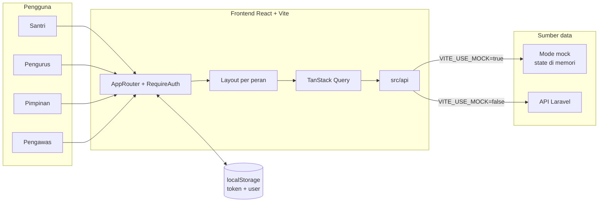

Catatan teknis:

- `src/api/index.js` memilih mock atau service asli secara otomatis.
- `src/api/client.js` memakai base URL `VITE_API_URL + "/api"` dan mengirim token sebagai `Authorization: Bearer`.
- Data mock hidup di memori dan kembali ke data awal saat halaman dimuat ulang.

## 3. Alur autentikasi dan sesi

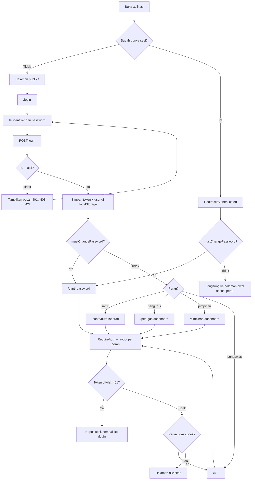

Perilaku sesi:

- Satu browser memakai satu akun; sesi disinkronkan antar-tab lewat `localStorage`.
- `RequireAuth` menjaga halaman berdasarkan login, peran, dan kewajiban ganti kata sandi.
- Semua peran, termasuk santri, yang memiliki `mustChangePassword` diarahkan ke `/ganti-password` dan tidak bisa membuka halaman lain sampai kata sandi diganti.
- Akun baru (pengurus buatan pimpinan maupun santri hasil impor) diberi `must_change_password: true`, sehingga pemilik akun wajib mengganti kata sandi awal saat pertama masuk.
- Respons `401` otomatis menghapus sesi dan mengarahkan ke `/login`.
- Respons `403` ditampilkan sebagai akses ditolak, tanpa membocorkan apakah data ada.

### Logout otomatis dan keluar cepat

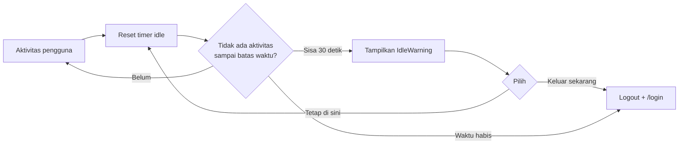

| Peran | Batas idle | Catatan |
| --- | --- | --- |
| Santri | 180 detik (default) | Ada tombol **Keluar Cepat** dan pintasan tombol `Esc` dua kali. |
| Pengurus/Pimpinan | 900 detik (default) | Logout biasa dari header/sidebar. |

## 4. Alur santri

### 4.1 Membuat laporan

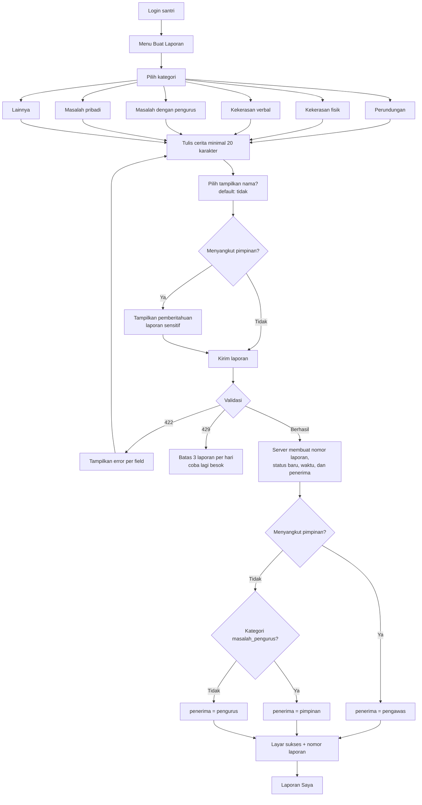

Aturan penting:

- Kategori `masalah_pengurus` langsung diteruskan ke pimpinan; UI menampilkan pemberitahuan sebelum dikirim.
- Sakelar **Menyangkut pimpinan** menandai laporan sebagai sensitif (`menyangkut_pimpinan`). Laporan sensitif hanya dapat dibaca pelapor dan pengawas; pengurus/pimpinan tidak melihatnya di daftar maupun detail.
- Identitas **default tersembunyi**. Santri dapat menyalakan opsi tampilkan nama saat membuat laporan atau mengubahnya kapan saja di detail laporan.
- Batas 3 laporan per hari dan minimal 20 karakter adalah perilaku mock; backend dapat memvalidasi ulang (lihat `API_ASSUMPTIONS.md`).

### 4.2 Laporan Saya dan detail laporan

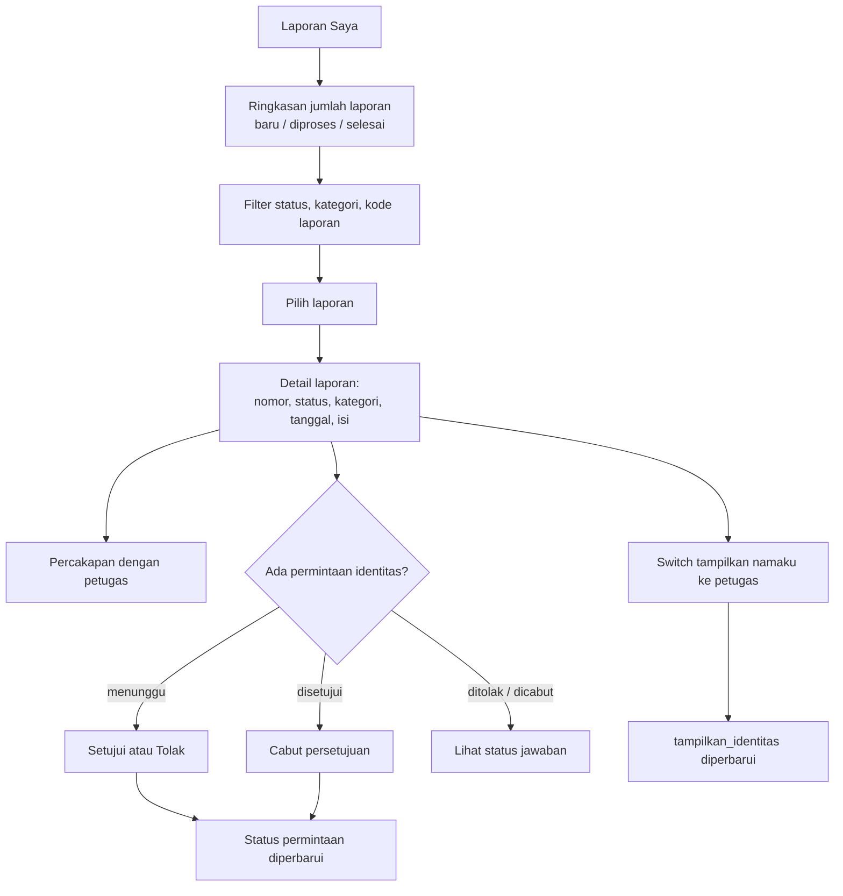

- Laporan yang memiliki permintaan identitas berstatus `menunggu` ditandai di daftar.
- Membuka detail laporan atau percakapan menandai notifikasi terkait sudah dibaca.
- Santri hanya bisa membuka laporan miliknya sendiri.

### 4.3 Teman Cerita (AI)

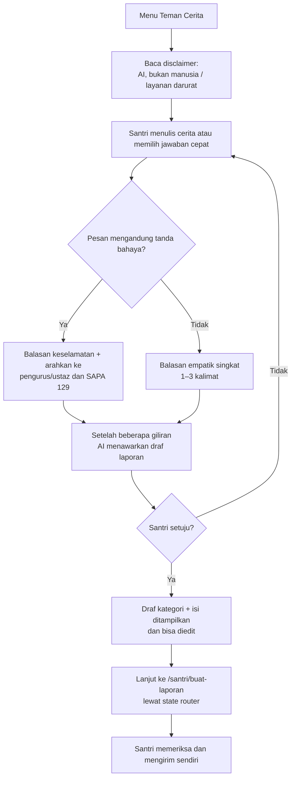

- Fitur ini hanya untuk santri dan tidak muncul di UI petugas/pimpinan.
- `VITE_USE_AI_MOCK=false` memakai AI asli backend melalui `POST /chat`. Bila variabel tidak diisi, nilainya mengikuti `VITE_USE_MOCK` (mock → balasan tiruan, API asli → AI asli). Set `true` untuk memaksa balasan tiruan.
- Percakapan Teman Cerita disimpan per akun di `localStorage` agar tidak hilang saat pindah halaman; riwayat hanya dihapus lewat tombol "Mulai ulang". Draf tidak disimpan dan hanya diteruskan lewat state router.
- AI tidak pernah mengirim laporan otomatis. Laporan tetap harus dikirim santri dari form.
- Untuk backend asli, lihat asumsi endpoint AI di [`API_ASSUMPTIONS.md`](./API_ASSUMPTIONS.md).

## 5. Alur pengurus

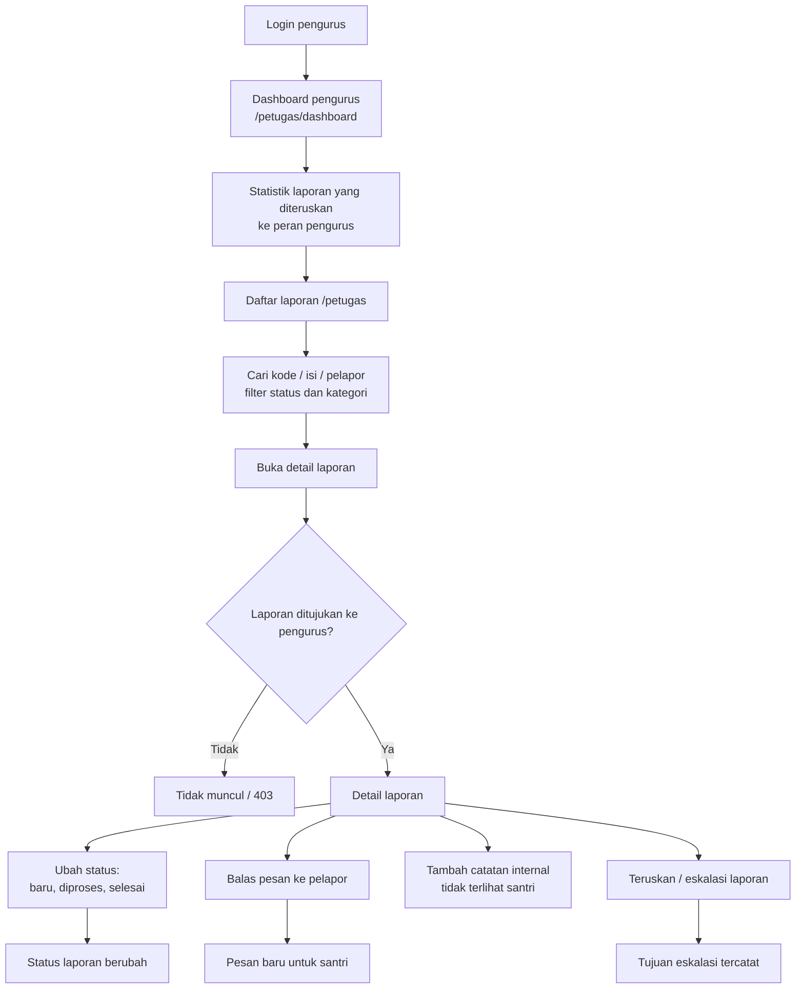

- Pengurus tidak melihat kartu permintaan identitas; data itu hanya untuk pimpinan dan pelapor. Backend juga tidak boleh mengirim field `permintaan_identitas` kepada pengurus.
- Nama pelapor tampil bila `tampilkan_identitas` aktif. Saat ini backend juga mengaktifkannya ketika santri menyetujui permintaan pimpinan, sehingga pengurus dan pimpinan sama-sama melihat nama. Jika kebijakan hanya pimpinan, backend harus mengirim nama hanya untuk pimpinan tanpa menyalakan flag. Selain itu UI menampilkan `Pelapor (identitas disembunyikan)`.
- Daftar menandai laporan yang melewati `batas_klarifikasi` sebagai **Lewat batas**. Ini indikator visual, bukan pembatasan otomatis.
- Catatan internal hanya dapat dibaca dan ditulis oleh petugas (pengurus/pimpinan).

## 6. Alur pimpinan

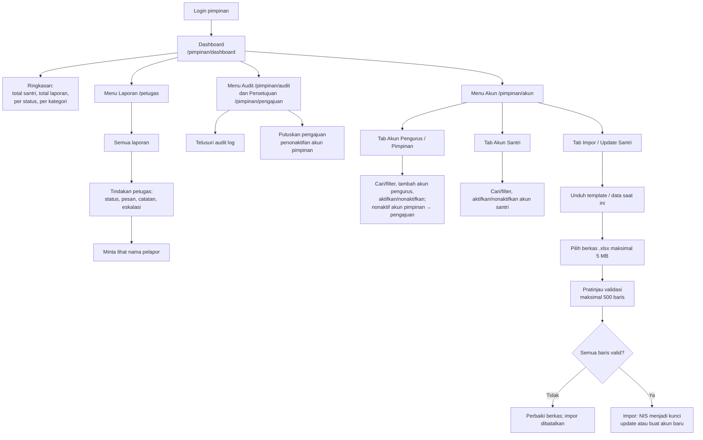

Ketentuan impor/ekspor santri:

- Format `.xlsx`, maksimal 5 MB dan 500 baris.
- NIS dipakai untuk memperbarui akun lama atau membuat akun baru.
- Akun lama boleh memakai password kosong (password lama tidak berubah).
- Akun baru wajib password minimal 8 karakter.
- Ekspor memuat data akun terkini dengan kolom yang sama; password dikosongkan.
- Santri yang tidak tercantum pada berkas tidak dihapus atau dinonaktifkan.

## 7. Alur pengawas, laporan sensitif, audit, dan persetujuan akun

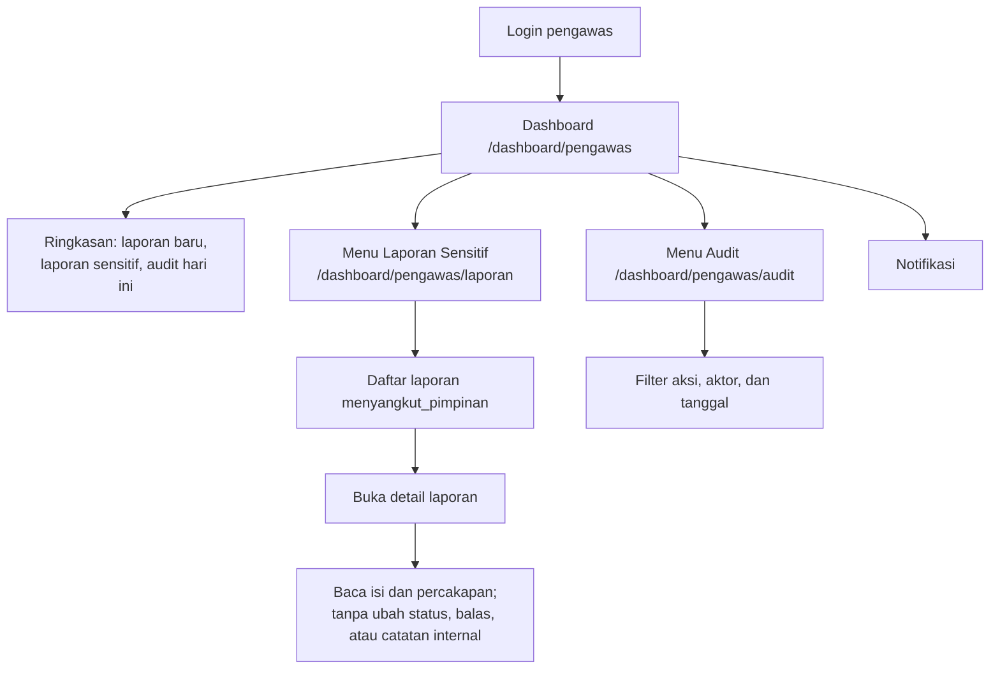

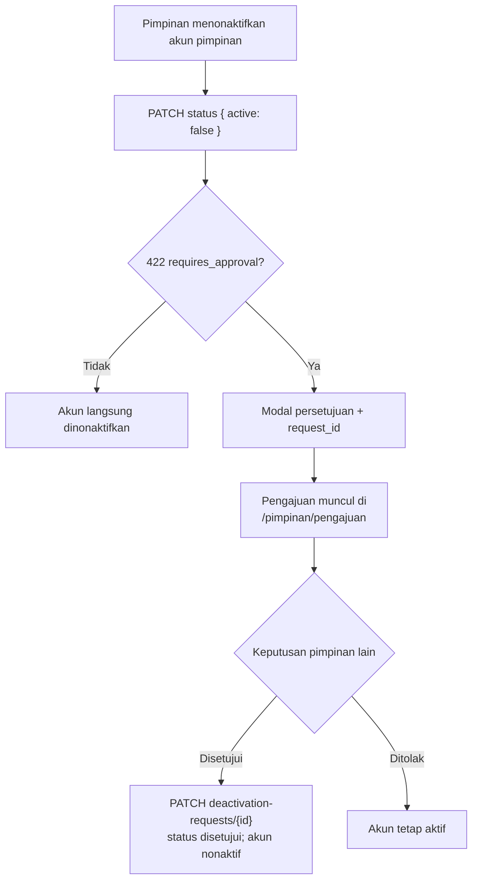

Aturan:

- Laporan sensitif (`menyangkut_pimpinan`) hanya terlihat pelapor dan pengawas; pengurus/pimpinan mendapat 403/tidak melihatnya.
- Pengawas bersifat baca-saja: tombol ubah status, balas pesan, dan catatan internal disembunyikan.
- Audit log memakai `GET /admin/audit-logs` dan menampilkan tanggal + jam; halaman lain tetap menampilkan tanggal saja.
- Penonaktifan akun pimpinan membutuhkan persetujuan dua orang. Frontend menangkap `requiresApproval` pada error 422, bukan endpoint approve/reject terpisah.
- Pengawas hanya tersedia di mode mock sampai backend menyediakan peran dan route terkait.

## 8. State machine status laporan

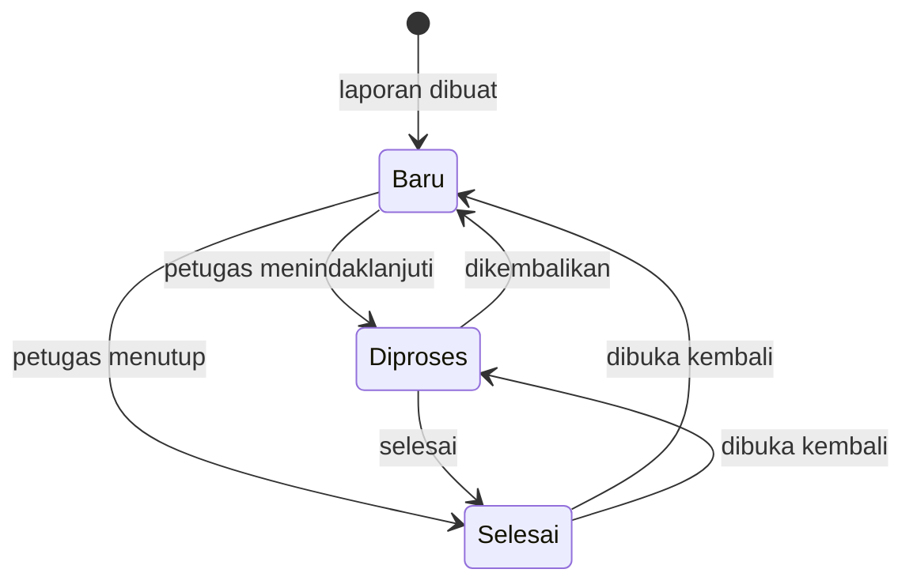

Catatan:

- UI menyediakan ketiga status pada dropdown, sehingga perpindahan antar status dimungkinkan; backend tetap yang memvalidasi.
- Aksi **kirim pesan**, **catatan internal**, dan **eskalasi** tidak mengubah status laporan.
- Pada mock, `perlu_klarifikasi` dimatikan saat status diubah ke selain `baru`.

## 9. Alur permintaan identitas

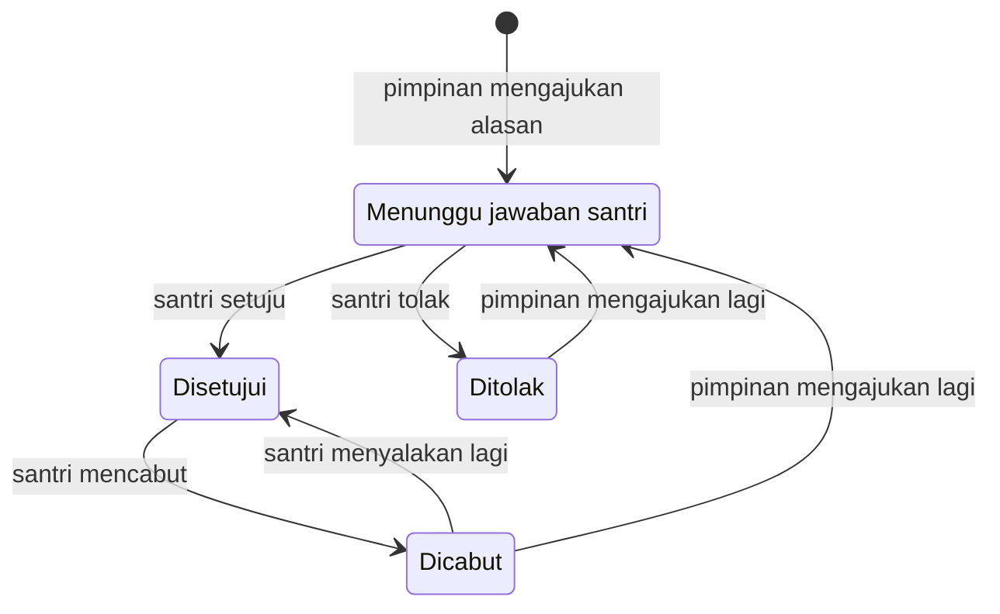

Aturan visibilitas nama:

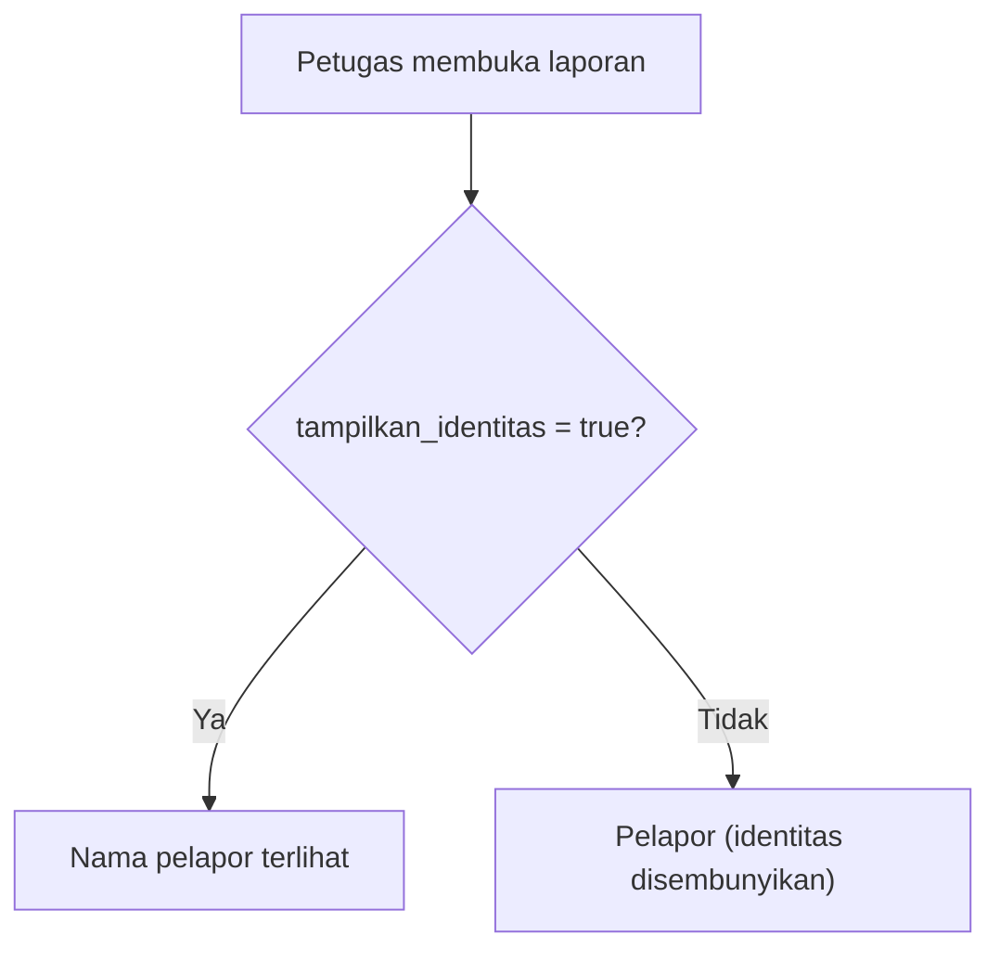

- Permintaan baru hanya bisa diajukan pimpinan.
- Pimpinan mengisi alasan (20–1000 karakter) dan boleh melampirkan bukti JPG/PNG/PDF maksimal 5 MB.
- Permintaan ditolak `409` jika masih ada permintaan `menunggu` atau sudah `disetujui`.
- Santri dapat menolak tanpa memengaruhi proses laporan.
- Persetujuan saat ini mengaktifkan `tampilkan_identitas`, sehingga pengurus dan pimpinan dapat melihat nama. Jika kebijakan hanya pimpinan, backend harus mengirim nama hanya ke pimpinan tanpa menyalakan flag.
- Jika santri mencabut persetujuan, status permintaan menjadi `dicabut` dan nama kembali disembunyikan.

## 10. Alur notifikasi

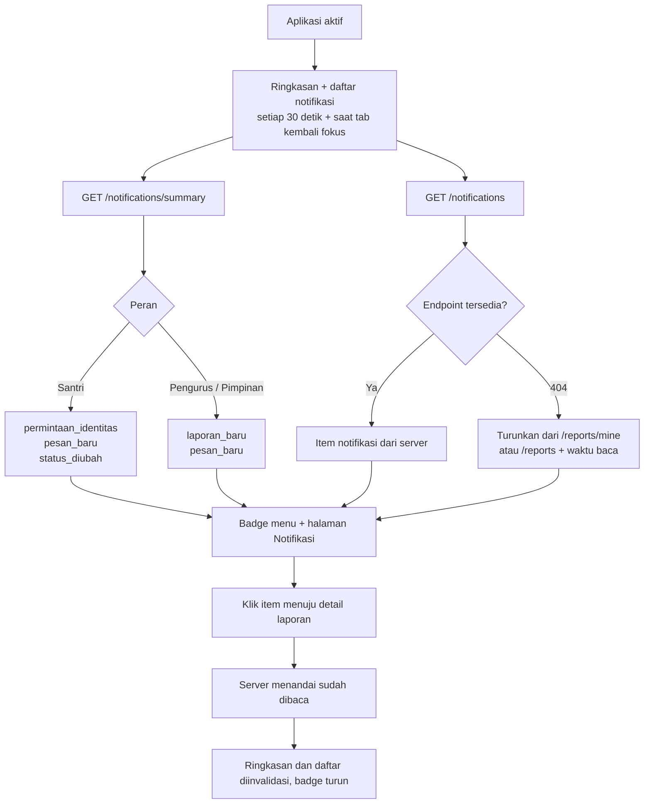

| Peran | Kategori | Pemicu |
| --- | --- | --- |
| Santri | `permintaan_identitas` | Ada permintaan `menunggu` yang lebih baru dari waktu baca terakhir. |
| Santri | `pesan_baru` | Ada pesan dari pengguna lain setelah waktu baca terakhir. |
| Santri | `status_diubah` | Status laporan berubah setelah waktu baca terakhir. |
| Pengurus/Pimpinan | `laporan_baru` | Ada laporan `baru` yang belum pernah dibuka oleh peran tersebut. |
| Pengurus/Pimpinan | `pesan_baru` | Ada pesan dari pengguna lain pada laporan yang belum `selesai`. |

`pembaruan` adalah jumlah seluruh kategori; satu laporan dapat terhitung di lebih dari satu kategori.

Halaman Notifikasi menampilkan satu item per kategori per laporan (mis. satu laporan bisa muncul sebagai "pesan baru" dan "status berubah"). Setiap item langsung menuju detail laporan sesuai peran: `/santri/laporan/{id}` untuk santri, `/petugas/laporan/{id}` untuk pengurus/pimpinan. `GET /notifications` sudah tersedia dan mengembalikan hanya item belum dibaca. Bila endpoint mengembalikan `404`, frontend memakai fallback dengan menurunkan daftar dari data laporan dan waktu baca per peran (`santri_dibaca`, `pengurus_dibaca`, `pimpinan_dibaca`).

## 11. Peta route dan hak akses

| Route | Akses | Halaman |
| --- | --- | --- |
| `/` | Publik | Landing page |
| `/login` | Publik (redirect jika sudah login) | Login |
| `/ganti-password` | Semua yang login | Ganti kata sandi |
| `/santri` | Santri | Redirect ke `/santri/buat-laporan` |
| `/santri/buat-laporan` | Santri | Buat laporan |
| `/santri/teman-cerita` | Santri | Teman Cerita (AI, mock) |
| `/santri/laporan-saya` | Santri | Daftar laporan miliknya |
| `/santri/laporan/:id` | Santri (pemilik) | Detail laporan |
| `/santri/notifikasi` | Santri | Daftar notifikasi |
| `/santri/profil` | Santri | Profil |
| `/petugas` | Pengurus, Pimpinan | Daftar laporan |
| `/petugas/dashboard` | Pengurus | Dashboard pengurus |
| `/petugas/laporan/:id` | Pengurus, Pimpinan | Detail laporan |
| `/petugas/notifikasi` | Pengurus, Pimpinan | Daftar notifikasi |
| `/petugas/profil` | Pengurus, Pimpinan | Profil |
| `/pimpinan` | Pimpinan | Redirect ke `/pimpinan/dashboard` |
| `/pimpinan/dashboard` | Pimpinan | Dashboard ringkasan |
| `/pimpinan/akun` | Pimpinan | Kelola akun, impor/ekspor santri |
| `/pimpinan/audit` | Pimpinan | Audit log |
| `/pimpinan/pengajuan` | Pimpinan | Persetujuan penonaktifan akun pimpinan |
| `/pimpinan/notifikasi` | Pimpinan | Daftar notifikasi |
| `/pimpinan/profil` | Pimpinan | Profil |
| `/dashboard/pengawas` | Pengawas, Pimpinan | Dashboard pengawas |
| `/dashboard/pengawas/laporan` | Pengawas | Daftar laporan sensitif |
| `/dashboard/pengawas/laporan/:id` | Pengawas | Detail laporan sensitif (baca-saja) |
| `/dashboard/pengawas/audit` | Pengawas, Pimpinan | Audit log |
| `/dashboard/pengawas/notifikasi` | Pengawas, Pimpinan | Daftar notifikasi |
| `/dashboard/pengawas/profil` | Pengawas, Pimpinan | Profil |
| `/pengawas` | Pengawas | Redirect ke `/dashboard/pengawas` |
| `/403` | Publik | Akses ditolak |
| `*` | Publik | Halaman tidak ditemukan |

## 12. Endpoint utama yang tersedia untuk frontend

Base URL pemanggilan: `VITE_API_URL + "/api"`. Tabel di bawah memakai jalur relatif terhadap base tersebut (sesuai service di `src/api/services`).

| Kelompok | Metode & jalur | Peran | Kegunaan |
| --- | --- | --- | --- |
| Auth | `POST /auth/login` | Publik | Masuk dan memperoleh token |
| Auth | `POST /auth/password` | Login | Ganti kata sandi |
| Auth | `POST /logout` | Login | Keluar |
| Laporan | `POST /reports` | Santri | Membuat laporan |
| Laporan | `GET /reports/mine` | Santri | Daftar laporan sendiri |
| Laporan | `GET /reports` | Pengurus, Pimpinan, Pengawas | Daftar laporan sesuai akses peran (pengawas: hanya sensitif) |
| Laporan | `GET /reports/{id}` | Pemilik / petugas berhak / pengawas untuk laporan sensitif | Detail laporan |
| Laporan | `PATCH /reports/{id}/identity` | Santri | Ubah `tampilkan_identitas` |
| Laporan | `PATCH /reports/{id}/status` | Pengurus, Pimpinan | Ubah status |
| Laporan | `POST /reports/{id}/escalate` | Pengurus, Pimpinan | Teruskan laporan |
| Identitas | `POST /reports/{id}/identity-request` | Pimpinan | Ajukan permintaan melihat nama |
| Identitas | `PATCH /reports/{id}/identity-request` | Santri | Setujui (`1`) atau tolak (`0`) |
| Pesan | `GET /reports/{id}/messages` | Pemilik / petugas berhak | Baca percakapan |
| Pesan | `POST /reports/{id}/messages` | Pemilik / petugas berhak | Kirim pesan |
| Catatan | `POST /reports/{id}/notes` | Pengurus, Pimpinan | Tambah catatan internal |
| AI | `POST /chat` | Santri | Kirim `{ message, history }` dan terima balasan Teman Cerita (asumsi) |
| AI | `POST /ai/conversations/{id}/draft` | Santri | Buat draf laporan dari percakapan (asumsi) |
| Notifikasi | `GET /notifications/summary` | Login | Ringkasan badge notifikasi |
| Notifikasi | `GET /notifications` | Login | Daftar item notifikasi belum dibaca (fallback bila `404`) |
| Dashboard | `GET /dashboard/summary` | Pimpinan, Pengawas | Ringkasan dashboard |
| Admin | `GET /admin/santri/template` | Pimpinan | Template impor (tersedia di service; UI saat ini membuat template lokal) |
| Admin | `POST /admin/santri/import` | Pimpinan | Pratinjau / impor santri |
| Admin | `GET /admin/santri/export` | Pimpinan | Ekspor data santri |
| Admin | `GET /admin/accounts` | Pimpinan | Daftar akun petugas (asumsi) |
| Admin | `POST /admin/accounts` | Pimpinan | Buat akun pengurus (asumsi) |
| Admin | `PATCH /admin/accounts/{id}/status` | Pimpinan | Aktif/nonaktif akun; akun pimpinan butuh persetujuan (asumsi) |
| Admin | `GET /admin/deactivation-requests` | Pimpinan | Daftar pengajuan penonaktifan akun pimpinan (asumsi) |
| Admin | `PATCH /admin/deactivation-requests/{id}` | Pimpinan | Setujui/tolak pengajuan penonaktifan (asumsi) |
| Audit | `GET /admin/audit-logs` | Pengawas, Pimpinan | Audit log tindakan sensitif |
| Kesehatan | `GET /health` | Opsional | Health check kios/demo |

Catatan: `API_ASSUMPTIONS.md` menuliskan sebagian endpoint dengan prefix `/api/v1`, sedangkan `src/api/client.js` memakai `${VITE_API_URL}/api`. Samakan prefix ini dengan backend sebelum rilis produksi. Endpoint `template` dan `health` tersedia di kontrak/service, tetapi belum dipakai oleh UI saat ini.

## 13. Aturan privasi dan keamanan yang berlaku

- Nama pelapor disamarkan secara default; hanya terbuka bila santri menyalakan `tampilkan_identitas`. Saat ini persetujuan permintaan pimpinan juga menyalakan flag tersebut, jadi pengurus dan pimpinan sama-sama melihat nama.
- Pengurus tidak menerima data permintaan identitas dan tidak pernah melihat NIS/nomor santri di UI.
- Laporan `menyangkut_pimpinan` hanya dapat dibaca pelapor dan pengawas; pengurus dan pimpinan tidak menerima laporan itu dari API.
- Tanggal pada UI petugas ditampilkan tanpa jam, kecuali waktu pada audit log.
- Isi laporan dan draf tidak disimpan di browser. Hanya token sesi dan riwayat Teman Cerita (per akun) yang disimpan di `localStorage`; riwayat AI dihapus lewat tombol "Mulai ulang".
- Semua permintaan API mengirim token `Bearer`; respons `401` memicu logout otomatis.
- CSP membatasi koneksi ke `'self'` dan origin API produksi yang tercantum di `connect-src`; perbarui daftar itu bila origin API berubah.

## 14. Rujukan kode

| Bagian | File utama |
| --- | --- |
| Routing & proteksi peran | `src/routes/AppRouter.jsx`, `src/features/auth/RequireAuth.jsx` |
| Login & sesi | `src/pages/LoginPage.jsx`, `src/features/auth/AuthProvider.jsx`, `src/lib/session.js` |
| Idle & keluar cepat | `src/features/auth/useIdleTimer.js`, `src/features/auth/IdleWarning.jsx`, `src/layouts/SantriLayout.jsx` |
| Alur santri | `src/pages/santri/CreateReportPage.jsx`, `MyReportsPage.jsx`, `SantriReportDetailPage.jsx` |
| Alur petugas | `src/pages/staff/StaffReportListPage.jsx`, `StaffReportDetailPage.jsx` |
| Alur pimpinan | `src/pages/pimpinan/DashboardPage.jsx`, `AccountsPage.jsx`, `DeactivationRequestsPage.jsx` |
| Alur pengawas | `src/pages/pengawas/PengawasDashboardPage.jsx`, `SensitiveReportListPage.jsx`, `AuditLogPage.jsx` |
| Audit & persetujuan | `src/features/audit/hooks.js`, `src/features/deactivation/hooks.js`, `src/api/services/audit.js`, `src/api/services/deactivation.js` |
| Identitas | `src/features/identity/IdentityRequestStaff.jsx`, `IdentityRequestSantri.jsx` |
| Teman Cerita (AI) | `src/pages/santri/TemanCeritaPage.jsx`, `src/features/ai-chat/*`, `src/api/services/ai.js`, `src/api/mock/index.js` |
| Notifikasi | `src/features/notifications/hooks.js`, `queryKeys.js`, `src/api/services/notifications.js`, `src/pages/NotifikasiPage.jsx` |
| Kontrak API | `API_ASSUMPTIONS.md`, `src/api/services/*.js`, `src/api/mock/index.js` |
